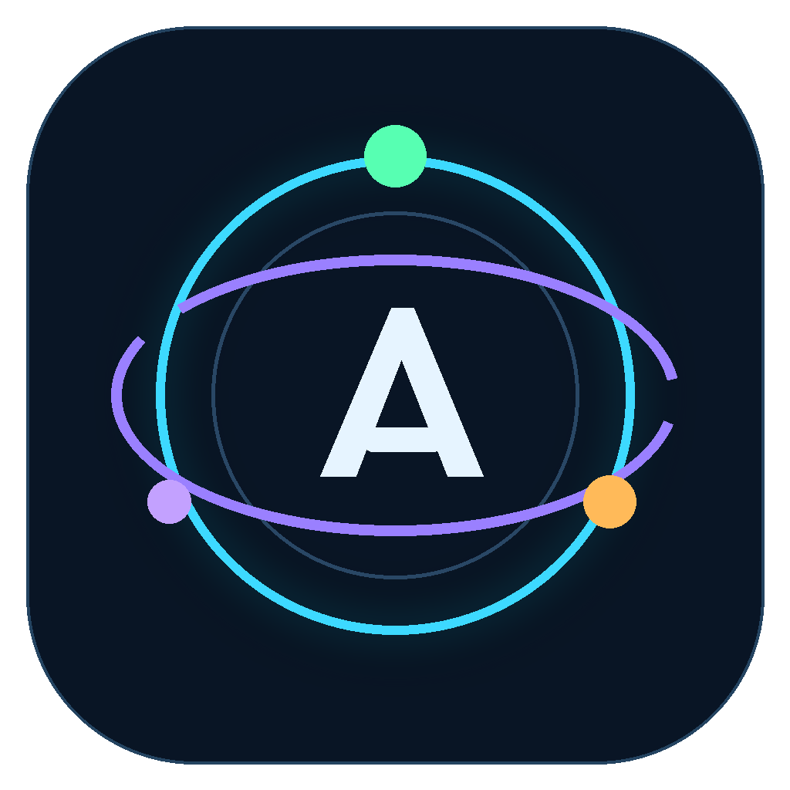
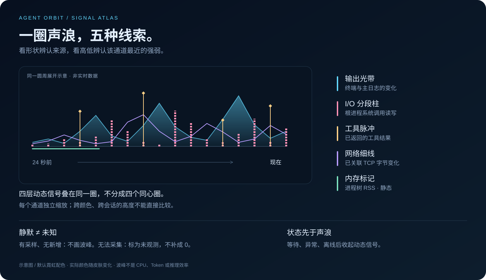

<div align="center">



# Agent Orbit

### Keep your agents in sight.

**CLI 在工作，桌面有回声。需要你时，一眼看见。**

独立 macOS 应用 · 本机 Codex CLI · SSH 远端 Codex CLI / Claude Code CLI

[](https://github.com/Arkaida/agent-orbit/releases/tag/v5.3.3)
[](LICENSE)
[](https://github.com/Arkaida/agent-orbit/actions/workflows/ci.yml)

[**下载 5.3.3**](https://github.com/Arkaida/agent-orbit/releases/tag/v5.3.3) · [**首次配置指南**](https://github.com/Arkaida/agent-orbit/blob/main/docs/GETTING_STARTED.zh-CN.md) · [声浪图解](docs/WAVE_GUIDE.zh-CN.md)


</div>

Agent Orbit 将你已有的 **CLI Agent 会话**放在桌面边缘：运行、等待输入、需要确认和异常，各有清楚的状态。无需反复切回终端，也能及时接住下一轮工作。

A standalone native macOS monitor for **local Codex sessions and Linux SSH/tmux Codex CLI / Claude Code CLI sessions**. See when they need input and return to your work. No Codex plugin, external Python or Node.js is required to run the app.

> **5.3.3** · 五路真实活动、六种统一声浪皮肤，以及 Claude 后台实验与 Codex 长任务识别。上图为早期版本的虚构数据界面，当前五层声浪见下方图解。[更新记录](docs/RELEASES.md)

## 从“还在跑吗”到“该我继续了”

| 看状态 | 看进展 | 回到工作 |
| --- | --- | --- |
| 已确认结束后显示等待；需要批准、回答或处理错误时单独提醒 | 会话环保留近期真实活动，悬停查看数值、峰值与采集覆盖 | 远端回到原 tmux 会话，本机会话唤起 Codex 客户端 |
| 完成与异常分别控制声音，恢复后清除旧问题 | 每会话的等待时间、运行时间、Token 与工具完成速度 | 单击切换迷你球，双击展开面板，拖动放到顺手的位置 |

**应用自己运行。** 双击 `.app` 即可启动。它读取你已有的会话，不启动或接管 Agent，也不向 CLI 发送输入。

## 五路活动声浪，一条时间轴

对话输出、CPU、磁盘、GPU、网络共用同一条圆周基线和同一种声浪皮肤，以五种颜色区分来源。最近 **24 秒**顺时针展开；纯文字输出时，即使硬件活动很低，对话输出层仍会变化。



| 通道与默认色 | 读到的信号 |
| --- | --- |
| 薄荷 · **对话输出** | 新增正文的观测字符，排除输入草稿、计时器和日志元数据 |
| 青蓝 · **CPU** | 进程树执行时间差，`100%` 为一个逻辑核 |
| 玫红 · **磁盘** | 活跃线程实际磁盘读写增量，缓存与终端字符不冒充读盘 |
| 琥珀 · **GPU** | NVIDIA 逐进程 SM 采样点，显存占用不冒充计算 |
| 紫色 · **网络** | 可关联 TCP 收发字节，共享与部分覆盖有标记 |

前台不输出时，已绑定后台实验的进展仍可保持运行状态。等待、异常、待核实与离线会清除动态历史；未知指标不补成零。RSS、Token 与工具速度保留在独立说明和用量中，不再驱动旧声浪。

绘图按活动与自身开销自适应，GPU 独立低频批量采样；视觉插值不会补造流量或延迟状态。[进程采集与覆盖边界](docs/PROCESS_COLLECTION.zh-CN.md)

设置 → 外观 → **声浪皮肤**：选择光柱、辉光、极光、雷达、曲线或端点，五层造型一起切换。选“跟随界面皮肤”时使用窗口皮肤的默认造型；单独选择后保留该声浪皮肤。波峰继续来自实际观测；无输出、无硬件活动时不制造波动。

**从应用里也能看懂：** 悬浮球右键 → **声浪图说明…**，或设置 → 外观 → **声浪图说明…**。[完整图例、阅读示例与平台覆盖](docs/WAVE_GUIDE.zh-CN.md)

## 围绕你的工作方式

- **本机与远端并看。** 自动发现本机 Codex 会话；通过已有 SSH 读取远端 tmux 中的 Codex / Claude。关注列表和连接状态各自独立。
- **需要你时再提醒。** 各会话保留等待时长、运行时长与久等提醒，可稍后提醒或静音本轮。主任务结束不会被保留的 shell 数量遮住。
- **互斥任务可以成组。** 自选成员，整个组在圆周占一个位置，合并空闲／运行计时与去重用量。任一成员工作时不催其他成员，随时可拆组。
- **小窗与悬浮球都能换肤。** 四套皮肤覆盖窗口、名字、状态和声浪；调高度、密度、透明度与大小。会话状态色和活动通道色各有明确职责。
- **数字有来源。** Token 取自 CLI 实际用量记录；工具速度按已返回结果计数。缺失与部分统计明确显示，不把未知数据补成零。
- **保留人工纠正入口。** 右键会话或组可手动标为运行中，新回复结果到达后自动解除。异常、待确认和离线始终优先。

## 第一次下载，如何配置

1. 在 [**5.3.3**](https://github.com/Arkaida/agent-orbit/releases/tag/v5.3.3) 的 **Assets** 下载 `Agent-Orbit-5.3.3-macos-arm64.zip`，用于 Apple Silicon Mac；Intel Mac 可从源码构建。`Source code` 不是可直接运行的应用。
2. 解压，将 **Agent Orbit.app** 放到“应用程序”或常用目录，双击打开。运行环境已内置，支持 **macOS 13+**。
3. 先打开你要监控的 Agent 会话，再点小窗齿轮或菜单栏 **AO → 设置… → 监控**，按下面选择来源，最后点底部 **保存设置**。

| 监控哪里 | 最少需要配置什么 | 成功标志 |
| --- | --- | --- |
| 本机 Codex | 默认已启用；数据目录通常为 `~/.codex`，保留“关注全部当前打开的本机会话”，保存 | 本机在线，出现已打开且可读取运行日志的 Codex 会话 |
| Linux 远端 Codex / Claude | 先确认无交互 SSH、Python 3 和 tmux 可用；开启远端监控，填 SSH 别名，默认 Socket 留空，关注列表每行一个 tmux session 名，保存 | 远端在线，出现目标会话名 |
| 本机和远端 | 同时保留两种来源开关，分别配置并保存 | 两种来源分别在线 |

**新安装默认只监控本机 Codex，不包含本机 Claude。** 尚未打开 Agent 时空列表属于正常情况；Orbit 不会替你启动任务。远端 CLI 需要在 tmux 中运行。SSH 主机框填 `work-server` 或 `user@host`，不要填一整条 `ssh` 命令；关注列表留空表示该 Socket 下全部会话。

第一次使用请按 [**首次配置指南**](https://github.com/Arkaida/agent-orbit/blob/main/docs/GETTING_STARTED.zh-CN.md) 操作：包含 SSH 配置示例、连接验证命令、会话名与 Socket 查找、逐项设置及常见问题，全程无需克隆源码或改 JSON。5.3.3 已修复旧安装包的远端进入按钮，双击卡片即可打开原 tmux 会话。

社区应用使用本地签名，尚未 Apple 公证；如系统阻止打开，请确认来源和校验值后，使用系统“隐私与安全性 → 仍要打开”流程。

### 从源码构建

下载应用的用户可跳过此节。需要主分支预览或 Intel 构建时，在 macOS 上安装 Xcode Command Line Tools 与 Python 3.9+ 后：

```bash
git clone https://github.com/Arkaida/agent-orbit.git
cd agent-orbit
sh build_desktop.sh
open 'Agent Orbit.app'
```

首次构建下载固定版本、经过 SHA-256 校验的可搬移 Python。构建后的应用可移到其他目录独立运行。Intel Mac 可在自己的机器上按同样步骤构建。

### 也可以从终端进入

这是一项可选的源码用法；只下载 `.app` 不会自动安装 `ao`。取得项目源码后，将 `source '/path/to/agent-orbit/shortcuts.zsh'` 加入 `~/.zshrc`，路径替换为项目位置，并在当前终端执行同一行或新开一个终端：

```bash
ao p                # 打开桌面应用
ao                  # 持续监控远端；未启用远端时监控本机
ao local            # 持续监控本机 Codex
ao + atlas nova     # 关注远端会话
ao atlas            # 进入原远端 tmux 会话
```

旧的 `cr`、`codex-remote` 命令继续兼容。退出 tmux 连接按 **Ctrl+B**，松开后按 **D**，任务继续运行。

## 只读、直接、留在你的设备上

无账户注册、遥测、云端中转或 HTTP 服务。远端经已有 SSH 连接读取；个人设置与关注列表留在本机，发布包不携带个人配置。连接诊断不保存对话正文。

CLI 的日志格式会变化。证据不足时显示待核实；静默、内存占用、后台终端存在或整台服务器繁忙都不会单独证明完成或仍在工作；后台活动必须关联到具体任务。声浪用于观察近期活动，状态负责告诉你是否需要返回会话。

<details>
<summary>早期版本视频 · 5.2.1 原生界面与虚构数据</summary>

https://github.com/user-attachments/assets/13b256c0-9bb2-414b-a473-045c255d25ad

[下载视频 MP4](https://github.com/Arkaida/agent-orbit/releases/download/v5.2.1/agent-orbit-demo.mp4)。视频展示早期界面，不包含 5.3.3 的五路声浪与新皮肤。

</details>

## 文档与贡献

| 使用 | 原理与开发 |
| --- | --- |
| [首次下载与配置](docs/GETTING_STARTED.zh-CN.md) | [常见连接问题](docs/GETTING_STARTED.zh-CN.md#按症状排查) |
| [完整使用指南](docs/USAGE.zh-CN.md) | [状态判断规则](docs/STATUS.md) |
| [声浪图解与常见问题](docs/WAVE_GUIDE.zh-CN.md) | [用量与资源指标](docs/METRICS.md) |
| [等待提醒与互斥组](docs/RESPONSE.md) | [统一皮肤接口](docs/THEMING.md) |
| [版本记录](docs/RELEASES.md) | [贡献指南](CONTRIBUTING.md) · [第三方许可](THIRD_PARTY_NOTICES.md) |

```bash
python3 -m unittest
sh scripts/check_orbit_waves.sh
sh build_desktop.sh
python3 scripts/package_release.py
```

不连接真实会话的演示：`open 'Agent Orbit.app' --args --demo`。欢迎提交脱敏截图、状态识别样例和改进建议。

**MIT License** · Independently built; not affiliated with OpenAI or Anthropic.
