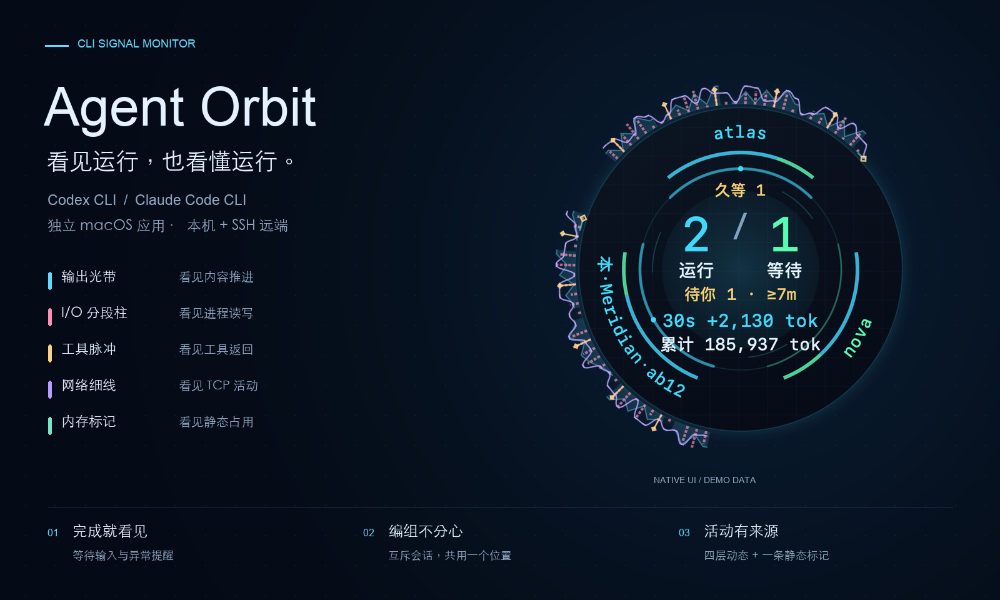

<div align="center">


# Agent Orbit

### Keep your agents in sight.

**CLI 在工作，桌面有回声。需要你时，一眼看见。**

独立 macOS 应用 · 本机 Codex CLI · SSH 远端 Codex CLI / Claude Code CLI

[](https://github.com/Arkaida/agent-orbit/releases/tag/v5.2.6)
[](LICENSE)
[](https://github.com/Arkaida/agent-orbit/actions/workflows/ci.yml)

[**下载稳定版 5.2.6**](https://github.com/Arkaida/agent-orbit/releases/tag/v5.2.6) · [**声浪图解**](docs/WAVE_GUIDE.zh-CN.md) · [使用指南](docs/USAGE.zh-CN.md)



</div>

Agent Orbit 将你已有的 **CLI Agent 会话**放在桌面边缘：运行、等待输入、需要确认和异常，各有清楚的状态。无需反复切回终端，也能及时接住下一轮工作。

A standalone native macOS monitor for **Codex CLI and Claude Code CLI**. Follow local or SSH/tmux sessions, see when they need input, and return to the original conversation. No Codex plugin, external Python or Node.js is required to run the app.

> **版本提示** · 稳定下载为 **5.2.6**。上图与下方「四路活动声浪」展示 **main 预览版 5.2.7 / build 33**，尚未发布新安装包；体验新声浪请从 main 构建。5.2.6 的下载包仍使用上一版资源声浪。[更新记录](docs/RELEASES.md)

## 从“还在跑吗”到“该我继续了”

| 看状态 | 看进展 | 回到工作 |
| --- | --- | --- |
| 已确认结束后显示等待；需要批准、回答或处理错误时单独提醒 | 会话环保留近期真实活动，悬停查看数值、峰值与采集覆盖 | 远端回到原 tmux 会话，本机会话唤起 Codex 客户端 |
| 完成与异常分别控制声音，恢复后清除旧问题 | 每会话的等待时间、运行时间、Token 与工具完成速度 | 单击切换迷你球，双击展开面板，拖动放到顺手的位置 |

**应用自己运行。** 双击 `.app` 即可启动。它读取你已有的会话，不启动或接管 Agent，也不向 CLI 发送输入。

## 四路活动声浪，一条时间轴

**main 预览** · 输出光带、I/O 分段柱、工具针与菱形、网络细曲线，共用同一条圆周基线。最近 **24 秒**从旧到新顺时针展开；RSS 内存只保留一段静态细弧。层次来自真实数据和不同图形，不靠随机跳动。


| 图形与默认色 | 读到的信号 |
| --- | --- |
| 青蓝光带 · **输出** | 页面、运行记录或已确认后台进展的活动变化；不是字节或 Token 吞吐 |
| 玫红分段柱 · **I/O** | root 进程 `rchar/wchar` 系统调用字节变化；不等于纯磁盘读写 |
| 琥珀针 / 实心菱形 · **工具** | 主日志中工具返回了结果，包含失败结果；空心菱形仅表示仍有活动工具 |
| 紫色细曲线 · **网络** | 可关联 TCP 的收发变化；共享、部分覆盖会明确标注 |
| 薄荷静态弧 · **内存** | 已关联进程树的 RSS，占用信息保持静态 |

颜色随皮肤适配，图形含义保持不变。每个会话、每个通道独立缩放，柱高用于看**本通道近期起伏**，不用于跨会话比较效率。静默不生成新波峰，未知不填成零。进入等待、异常或离线，活动立即收起。

绘图节奏随可见性、活动和自身开销自适应：有新活动时更流畅，静默与迷你模式更克制。短暂视觉过渡只平滑已观测的高度，采样、状态和提醒独立更新，不靠补造流量制造动感。

**从应用里也能看懂：** 悬浮球右键 → **声浪图说明…**，或设置 → 外观 → **声浪图说明…**。[完整图例、阅读示例与平台覆盖](docs/WAVE_GUIDE.zh-CN.md)

## 围绕你的工作方式

- **本机与远端并看。** 自动发现本机 Codex 会话；通过已有 SSH 读取远端 tmux 中的 Codex / Claude。关注列表和连接状态各自独立。
- **需要你时再提醒。** 各会话保留等待时长、运行时长与久等提醒，可稍后提醒或静音本轮。主任务结束不会被保留的 shell 数量遮住。
- **互斥任务可以成组。** 自选成员，整个组在圆周占一个位置，合并空闲／运行计时与去重用量。任一成员工作时不催其他成员，随时可拆组。
- **小窗与悬浮球都能换肤。** 四套皮肤覆盖窗口、名字、状态和声浪；调高度、密度、透明度与大小。会话状态色和活动通道色各有明确职责。
- **数字有来源。** Token 取自 CLI 实际用量记录；工具速度按已返回结果计数。缺失与部分统计明确显示，不把未知数据补成零。
- **保留人工纠正入口。** 右键会话或组可手动标为运行中，新回复结果到达后自动解除。异常、待确认和离线始终优先。

## 三步开始

1. 在 [**稳定版 5.2.6**](https://github.com/Arkaida/agent-orbit/releases/tag/v5.2.6) 下载 Apple Silicon `arm64` 应用 ZIP。Intel Mac 可从源码构建。
2. 解压，将 **Agent Orbit.app** 放到“应用程序”或常用目录，双击打开。运行环境已内置，支持 **macOS 13+**。
3. 打开设置，选择本机关注会话；需要远端时填写已有 SSH 别名、tmux Socket 与关注列表。

远端需要可无交互登录的 SSH，以及已有的 Python 3、tmux 和 Agent 会话。社区应用使用本地签名，尚未 Apple 公证；如系统阻止打开，请确认来源和校验值后，使用系统“隐私与安全性 → 仍要打开”流程。

### 从 main 体验新声浪

在 macOS 上安装 Xcode Command Line Tools 与 Python 3.9+ 后：

```bash
git clone https://github.com/Arkaida/agent-orbit.git
cd agent-orbit
sh build_desktop.sh
open 'Agent Orbit.app'
```

首次构建下载固定版本、经过 SHA-256 校验的可搬移 Python。构建后的应用可移到其他目录独立运行。

### 也可以从终端进入

将 `source '/path/to/agent-orbit/shortcuts.zsh'` 加入 `~/.zshrc`，路径替换为项目位置：

```bash
ao p                # 打开桌面应用
ao                  # 持续监控远端；未启用远端时监控本机
ao local            # 持续监控本机 Codex
ao + atlas nova     # 关注远端会话
ao atlas            # 进入原远端 tmux 会话
```

旧的 `cr`、`codex-remote` 命令继续兼容。退出 tmux 连接按 **Ctrl+B**，松开后按 **D**，任务继续运行。

## 只读、直接、留在你的设备上

无账户注册、遥测、云端中转或 HTTP 服务。远端经已有 SSH 连接读取；个人设置与关注列表留在本机，发布包不携带个人配置。连接诊断不保存对话正文。

CLI 的日志格式会变化。证据不足时显示待核实；静默、内存占用、后台终端存在或网络活动都不会单独证明完成或仍在工作。声浪用于观察近期活动，状态负责告诉你是否需要返回会话。

<details>
<summary>早期版本视频 · 5.2.1 原生界面与虚构数据</summary>

https://github.com/user-attachments/assets/13b256c0-9bb2-414b-a473-045c255d25ad

[下载视频 MP4](https://github.com/Arkaida/agent-orbit/releases/download/v5.2.1/agent-orbit-demo.mp4)。视频展示早期界面，不包含 main 预览的新声浪。

</details>

## 文档与贡献

| 使用 | 原理与开发 |
| --- | --- |
| [完整使用指南](docs/USAGE.zh-CN.md) | [状态判断规则](docs/STATUS.md) |
| [声浪图解与常见问题](docs/WAVE_GUIDE.zh-CN.md) | [用量与资源指标](docs/METRICS.md) |
| [等待提醒与互斥组](docs/RESPONSE.md) | [统一皮肤接口](docs/THEMING.md) |
| [版本记录](docs/RELEASES.md) | [贡献指南](CONTRIBUTING.md) · [第三方许可](THIRD_PARTY_NOTICES.md) |

```bash
python3 -m unittest
sh scripts/check_orbit_waves.sh
sh build_desktop.sh
python3 scripts/package_release.py
```

不连接真实会话的演示：`open 'Agent Orbit.app' --args --demo`。欢迎提交脱敏截图、状态识别样例和改进建议。

**MIT License** · Independently built; not affiliated with OpenAI or Anthropic.
