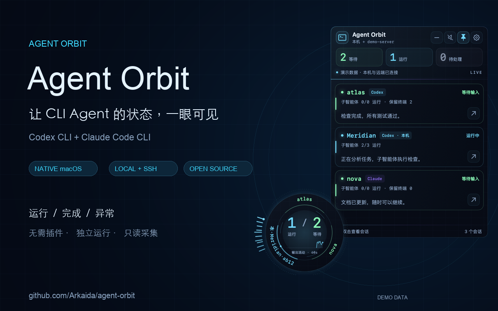
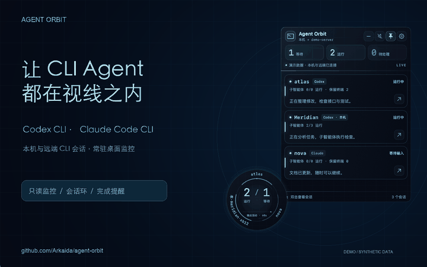
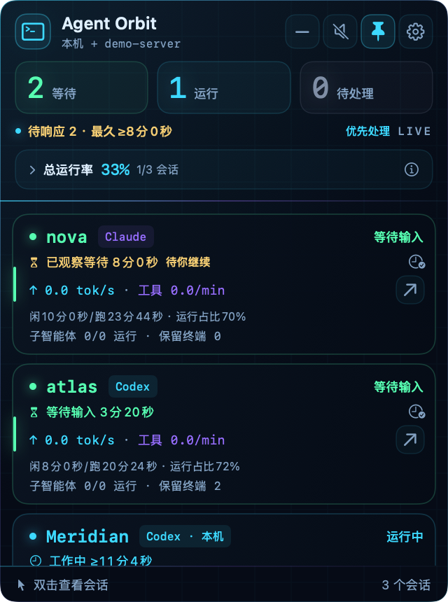
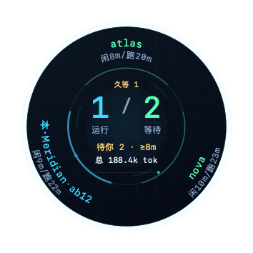
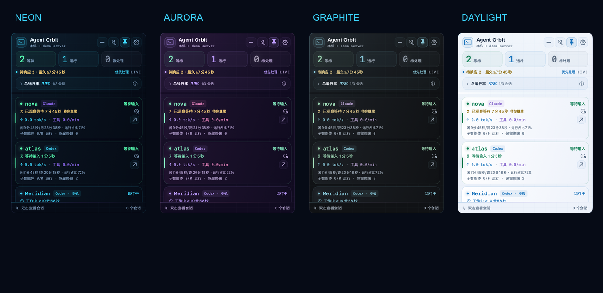
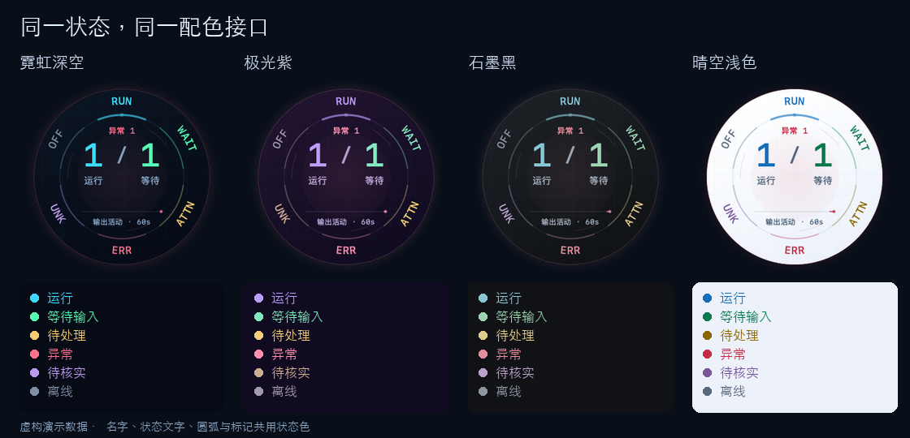
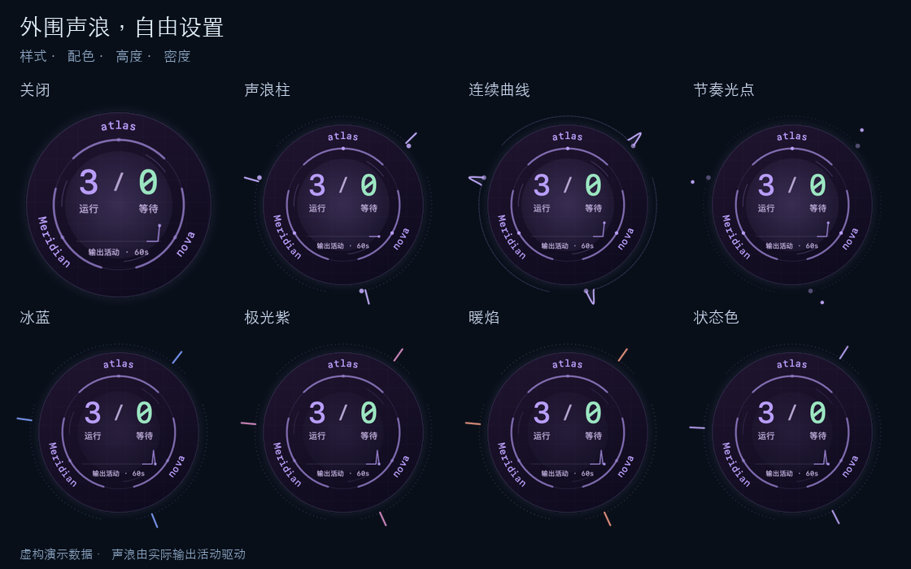
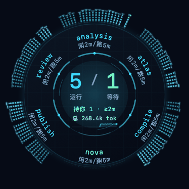

<div align="center">


# Agent Orbit

**Know when your agents need you.**

本机与远端 CLI Agent 的桌面会话环 · A native macOS monitor for Codex CLI & Claude Code CLI

[](https://github.com/Arkaida/agent-orbit/releases)
[](LICENSE)
[](https://github.com/Arkaida/agent-orbit/actions/workflows/ci.yml)

[**下载应用 / Download**](https://github.com/Arkaida/agent-orbit/releases/latest) · [中文使用指南](docs/USAGE.zh-CN.md) · [状态如何判断](docs/STATUS.md)



</div>

不必反复切回终端，看看 CLI Agent 做完了没有。**Agent Orbit 专注监控 Codex CLI 与 Claude Code CLI 会话**，常驻桌面，在任务等待输入、需要确认或遇到异常时，让你及时看到。

Monitor **Codex CLI and Claude Code CLI sessions** from a compact always-on-top window or floating ring. Supports local Codex CLI and remote Codex CLI / Claude Code CLI over SSH and tmux. See running, waiting and error states at a glance, with optional sound alerts.

> **独立应用。** 下载后双击 `.app` 即可运行，无需安装 Python、Node.js 或 Codex 插件，也不需要在 Codex 中启动。它读取你已有的会话，不启动或接管 Agent。

**5.2.6 更新**：右键会话或组可手动标为运行中，收到新的回复结果后自动解除；修复 Claude 完成状态和异步子智能体漏判，资源声浪改为同圈叠加、停止后立即收起，并以细双色弧表示空闲／运行比例。[更新说明](docs/RELEASES.md)

## 看看它如何工作

https://github.com/user-attachments/assets/13b256c0-9bb2-414b-a473-045c255d25ad

[下载完整介绍视频 MP4](https://github.com/Arkaida/agent-orbit/releases/download/v5.2.1/agent-orbit-demo.mp4)

视频可直接点击播放，展示 5.2.1 界面。全部画面使用应用原生界面与虚构会话数据，未录入真实桌面、主机或对话。

<details>
<summary>展开 GIF 动图预览</summary>

[](https://github.com/Arkaida/agent-orbit/releases/download/v5.2.1/agent-orbit-demo.mp4)

</details>

| 在桌面上看见 | 它代表什么 |
| --- | --- |
| 🟢 等待输入 | 主任务已确认结束，可以继续下一轮 |
| 运行中 | 正在思考、执行工具或有实际执行的子任务；使用皮肤运行色，经典配色下为橙色 |
| 🟡 待处理 | 需要确认、回答或处理暂停 |
| 🔴 异常 | 服务错误、中断、会话消失等，支持一次提示音 |
| 待核实 / 离线 | 状态证据不足，或对应来源当前不可用 |
| 会话环外的活动轨迹 | 最近输出或日志变化，**不是 CPU 或推理效率** |

## 你可以做什么

- **本机 + 远端 CLI 监控**：自动发现本机 Codex CLI；通过 SSH 读取远端 tmux 中的 Codex CLI / Claude Code CLI。连接状态彼此独立。
- **关注重要会话**：分别配置本机和远端关注列表；关闭设置后继续监控。
- **分会话效率与待响应**：逐个查看工作时长、等待时长、输出和工具速度；久等提醒可调整阈值、稍后提醒，回答后自动清除旧等待。[提醒规则](docs/RESPONSE.md)
- **独立或编组，由你配置**：设置中选成员创建互斥组，整个组在圆周上只占一个位置，面板合并为一张可展开的卡片；共用一段声浪、空闲／运行计时和去重后的用量。任一成员工作时不催其他成员，随时可移出或拆组，默认不自动编组。
- **两种悬浮球**：小号球显示待响应和最长等待，完整球显示圆周会话名；单击切换大小，双击打开面板，拖动移动，多会话自动双圈。
- **完成与异常提醒**：分别控制声音，恢复后自动移除旧异常，不展示执行历史。
- **手动运行标记**：遇到无输出但仍在工作的会话，可在悬浮球右键会话或组，选“手动标为运行中”；新回复结果到达后自动解除，也可随时取消。标记不会遮蔽异常或离线状态。
- **统一状态配色**：四套皮肤；名字、状态文字、圆弧与标记使用同一套状态色，可选择皮肤状态色或经典状态色。另可调整置顶、透明度、悬浮球尺寸及显示内容。
- **自定义外围声浪**：资源通道在同一圈叠加，只显示正在运行会话的真实活动；可调高度、密度与灵敏度，关闭资源模式后可选原有样式。名称旁的细双色比例弧表示累计空闲与运行占比，悬停查看具体时长。
- **实时 Token 数量**：悬浮球和各会话显示近 30 秒新增 Token，面板显示完整累计数字；同时查看运行占比、消耗速度、上游输出速度和工具完成速度。读取 CLI 实际用量记录，标明统计覆盖范围。[指标口径](docs/METRICS.md)
- **保留原工作方式**：远端卡片进入原 tmux 会话，本机卡片唤起 Codex 客户端。












全息声浪柱：分段柱身、亮色细芯、峰值短帽与输出触发的短拖尾。[四套皮肤预览](docs/media/spectrum-skins.png)

## 安装

1. 在 [Releases](https://github.com/Arkaida/agent-orbit/releases/latest) 下载应用 ZIP。当前提供 Apple Silicon 的 `arm64` 安装包；Intel Mac 可按下方开发说明从源码构建。
2. 解压，将 **Agent Orbit.app** 放到“应用程序”或任意常用目录，双击启动。
3. 点右上角齿轮打开设置。默认监控本机；远端模式填写已有 SSH 别名与 tmux Socket，选择关注会话。

应用支持 **macOS 13+**，运行环境已内置。远端模式需要可无交互登录的 SSH，以及远端已有的 Python 3、tmux 和 Agent 会话。

当前社区构建使用本地签名，尚未进行 Apple 公证。macOS 可能提示无法验证开发者；请仅在确认下载来源和校验值后，按系统提供的“隐私与安全性 → 仍要打开”流程操作。不要关闭系统安全保护。

## 可选：终端命令

源码目录中提供 `agent-orbit` 入口，会优先使用应用自带的运行环境。将下面一行加入 `~/.zshrc`，并替换为自己的项目位置：

```zsh
source '/path/to/agent-orbit/shortcuts.zsh'
```

```bash
ao p                # 打开桌面应用
ao                  # 持续监控远端；未启用远端时监控本机
ao local            # 持续监控本机 Codex
ao + atlas nova     # 关注远端会话
ao atlas            # 进入原远端 tmux 会话
```

旧的 `cr`、`codex-remote` 命令继续兼容。退出 tmux 连接按 **Ctrl+B**，松开后按 **D**，任务继续运行。

## 隐私与判断边界

- 只读采集，无账户注册、遥测、云端中转或对外 HTTP 服务。远端通过已有 SSH 连接读取。
- 设置与关注列表留在本机用户目录，源码和发布包不含个人配置。日志仅记录连接诊断，不保存对话正文。
- 保留终端的数量不会直接阻止主对话显示等待；无法可靠归属的本机后台终端数量会省略。
- Codex / Claude 的日志格式会变化；无法确认的状态明确显示待核实，不会把长时间静默直接判为完成。

详见 [状态规则](docs/STATUS.md)、[使用指南](docs/USAGE.zh-CN.md)、[待响应与悬浮球](docs/RESPONSE.md)、[用量指标](docs/METRICS.md)、[颜色分析与统一接口](docs/THEMING.md) 和 [第三方许可](THIRD_PARTY_NOTICES.md)。

## 开发与贡献

使用 macOS 的 Xcode Command Line Tools 与 Python 3.9+ 构建：

```bash
python3 -m unittest
sh build_desktop.sh
python3 scripts/package_release.py
```

首次构建下载固定版本、经过 SHA-256 校验的可搬移 Python 运行环境；安装后的应用不需要外部 Python。`dist/` 生成源码包、当前架构应用包与校验文件。CI 在 Linux / macOS 验证采集逻辑，在 macOS 构建应用。

不连接真实会话的演示模式：

```bash
open 'Agent Orbit.app' --args --demo
```

欢迎提交复现信息、状态识别样例、无个人内容的截图或改进建议。请先阅读 [CONTRIBUTING.md](CONTRIBUTING.md)。

**MIT License** · Independently built; not affiliated with OpenAI or Anthropic.
