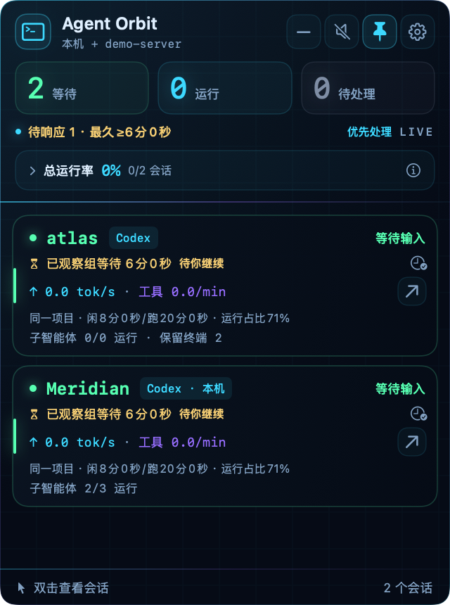

# 及时回到会话

分会话视图关注两件事：Agent 正在怎样推进，以及它已经等你多久。

- 运行时显示本次连续观察到的工作时长。
- 等待输入或确认时显示等待时长；首次遇到已在等待的会话用“已观察等待”或 `≥` 表示下界，不猜测打开监控前已等了多久。
- 已确认的运行到完成转换会使用本轮完成时间。后台终端数量、输出静默或 Token 速度不会单独判定任务完成。
- 每张卡提供该主会话自己的输出 Token/s 和工具结果次数/min；缺失显示 `—`。窗口和累计口径见 [用量指标](METRICS.md)。

顶部显示待响应数量与最长等待，可直接进入优先会话。卡片的等待状态继续用等待色；久等徽标使用提醒色，异常仍优先显示。

## 累计空闲 / 运行

完整球的圆周会话名下显示 `闲 Xm / 跑 Ym`，面板卡片同时提供运行占比。这里的“空闲”包括等待输入和需要你确认的时间；运行占比为 `运行 ÷ (空闲 + 运行)`，用于提醒自己及时处理会话，不代表 Agent 的任务质量或模型性能。

计时从本次监控开始，只累计连续、状态明确的观察区间。断线、未知、重试或错误期间暂停累计，恢复时不补算空窗。同一会话重连可保留已确认的累计；关注范围、进程或日志身份变化后重新统计，应用退出后不保存这本计时账。

## 可配置的互斥会话组

默认所有会话独立统计。到 **设置 → 监控 → 互斥会话组**，点“新建会话组”、填写组名，再勾选至少两个成员；保存后生效。支持同来源或跨本机与远端的成员，一个会话最多属于一个组。取消勾选可移出成员，删除组可让成员全部恢复独立。

- 组内任意成员运行时，组处于运行中，不催其他等待成员。
- 所有配置成员在线且明确等待时，开始共同空闲计时，全组每轮只提醒一次。
- 同组多个会话同时运行时，只显示冲突提示；运行时间仍按一段时间计算，不把成员时间叠加。
- 成员缺失、离线或状态不明时，不能确认整组空闲，暂停空闲累计和久等提醒。

圆周成员使用共同的组累计闲／跑时间，并带组标记；卡片保留该会话自己的状态和输出速度。改组会重新建立组计时。分组不会自动关注成员或启用来源，也不会启动、暂停或操作 Agent；先把所需成员纳入关注列表。

## 久等提醒

在“设置 → 提醒”配置开关、等待阈值和提示音。默认阈值为 **5 分钟**，可改为 1–120 分钟。每轮等待达到阈值后只响一次；多个会话同时到期合并成一次声音。声音总开关和独立的久等声音开关均生效。

“稍后提醒”会把本轮声音延后一个阈值周期。进入会话会静音这一轮提醒，等待时长仍保留；只有真实状态继续工作、问题已解除或会话变化时才清除旧等待。这样不会把“打开过终端”当成“已经回答”。

断线、未知状态和错误不触发久等声音。恢复连接后重新观察，不把无法确认的离线时间计入等待。改变关注列表、进程或日志身份时也重新确认；同一组多个窗格只提醒一次。

## 两种悬浮球

- **小号球**：基准 72px，默认缩放后约 61px。显示待响应数量、最久等待与久等数量，保留状态色。
- **完整球**：会话沿圆周排列，显示活动轨迹和更多概览。
- **单击**切换大小，**双击**打开面板，**按住拖动**移动。右键菜单也可切换大小或打开面板。

切换时保持球的中心位置，并自动留在屏幕内；选择的大小会记住。点击后会等待系统双击判定时间再切换大小，避免双击时误收起。

默认球缩放为 85%，外围声浪高度为 130%，均可在外观设置调整。新声浪包括等离子双波、极光光带和雷达涟漪，使用真实输出活动驱动；无活动时保持安静，开启减少动态效果时使用静态显示。

## 数据接口

桥接 JSON 流在每个 `rows` 对象上附加 `response`：

| 字段 | 说明 |
| --- | --- |
| `kind` | `running`、`waiting`、`attention`、`unknown` 或 `offline` |
| `episode_id` | 当前等待轮次的标识；运行、离线和未知时为空，用于提醒去重 |
| `since` | 当前状态起点的本机墙钟时间，仅供显示 |
| `elapsed_seconds` | 用单调时钟计算的持续秒数，避免系统时间调整影响提醒 |
| `observed` | `true` 表示只确认了观察起点，显示为持续时间下界 |
| `overdue` | 等待超过设置阈值且已启用提醒；不是任务完成信号 |
| `idle_seconds` / `run_seconds` | 当前监控范围累计确认的空闲 / 运行秒数 |
| `idle_run_ratio` | 空闲除以运行；运行尚为 0 时是 `null` |
| `efficiency_percent` | 运行时长占比，0–100；没有累计时是 `null` |
| `scope` | 固定为 `observed_monitoring`，不表示完整会话历史 |
| `reminder_suppressed` | 成员已编组，个体提醒由共同组提醒替代 |

同一 `source + group_id` 的多个窗格共享响应状态。`usage_metrics` 则属于该窗格确认归属的主日志，提供与全局同名的累计与速率字段，不混入其他会话的用量。断线时速率与等待计时不可用，旧累计可保留。

配置 `session_groups` 为 `[{"id":"work-pair","name":"实验组","members":["remote:atlas","local:thread-alpha"]}]`。`rows[].response_group` 为同组的共同计时，没有分组时是 `null`；字段包含上表的计时，以及 `id`、`name`、`members`、`count`、`known_members`、`running_members`、`parallel_conflict`。客户端应优先用 `response_group ?? response` 做组提醒，并按组 `id + episode_id` 去重；个体状态和主日志用量仍独立显示。成员标识使用桥接行的 `group_id`，不是展示名称。
