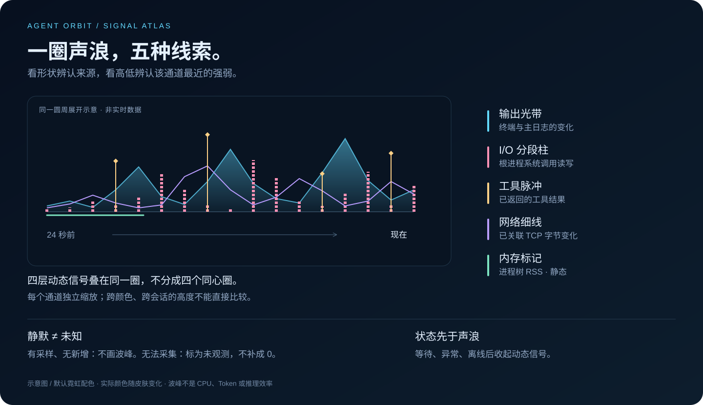

# 看懂活动声浪

适用于 [5.3.3 / build 39](https://github.com/Arkaida/agent-orbit/releases/tag/v5.3.3)。五路活动使用同一种声浪皮肤，在同一圆周叠加，以颜色区分来源。

声浪显示已关联会话的对话输出与硬件活动，会话名与状态色显示工作状态。前台停止输出时，后台实验仍可能持续使用 CPU 或 GPU。

## 五层与单位

每个会话或互斥组占一段圆周。五层叠在**同一条基线**，最近 **24 秒**顺时针从旧到新展开，不额外套五个同心圈。

| 通道 | 默认颜色 | 真实来源 | 如何理解 |
| --- | --- | --- | --- |
| **对话输出** `output` | 薄荷色 | Codex / Claude 明确新增的助手正文 | 观测字符／秒；不是Token计数或完整生成速度，终端折叠与采样间隔可能漏采 |
| **CPU** `cpu` | 青蓝色 | 已关联进程树的连续 CPU 执行时间差 | `100%` 为一个逻辑核，多核可超过 `100%` |
| **磁盘** `disk` | 玫红色 | 活跃线程 `read_bytes/write_bytes` 的连续增量 | `B/s`；缓存命中、管道和终端字符不等于磁盘吞吐，短命线程可能漏采 |
| **GPU** `gpu` | 琥珀色 | Linux NVIDIA 按进程报告的 SM 利用率 | 逐进程／设备SM百分比之和，可超过 `100%`；不是去重后的设备总利用率或显存占比 |
| **网络** `network` | 紫色 | 可关联 TCP socket 的收发计数增量 | `B/s`；不包含 UDP、网卡总流量或无法归属的连接 |

对话输出采用独立正文累计，不复用混合日志、后台事件与Token变化的旧活动量。工具事件计数与 `rchar/wchar` 不驱动声浪。Token 和工具速度仍是独立的会话指标；RSS 内存只在悬停说明中保留。

颜色随界面皮肤统一变化；声浪皮肤统一改变五层的几何造型。状态色与资源色分开：会话名变绿表示等待，不能用某层的颜色推断状态。

## 高低怎样读

每个会话、每个通道独立缩放，整段窗口共用一个标尺，结合近期峰值与固定单位参考柔和缩放。对话输出是观测字符增量，CPU是采样区间利用率，GPU是逐进程SM采样点，磁盘／网络是字节速度，不比较不同颜色的高度占比。

- 同一层更高，表示该时间段的数值更大。
- 两个会话一样高，不代表消耗或效率相同；悬停查看实际数字。
- 灵敏度只放大真实小变化，不补造活动。
- 正常零值不画波峰；没有采样时显示未观测，不补成零。

CPU区间样本按覆盖时间分配到视觉桶；GPU只显示实际采样点，不推断两次查询之间的利用率。同一缓存样本只计一次。绘图刷新不会补造正文或多采硬件数据，也不会增加 Token。

## 对话输出怎样监测

远端读取CLI终端的明确助手正文，本机读取已关联日志中的助手正文。长回复的起始标记可能滚出当前窗口，因此远端单次读取最多256行滚动上下文来确认归属；状态、预览和报错仍只看当前窗口，上下文不透传给界面。新增非空白字符形成波峰；输入草稿、提示词回显、光标、旋转指示、耗时、Token计数和日志元数据不贡献。硬件字段未观测时，输出层仍可单独工作。

首次看到的历史、重连、重新开始运行和日志身份变化先建立基线；整屏替换且无法确认连续性时也不补播。将采样间隔设为3秒或5秒时，连续性阈值随设置调整；重复旧样本不会续鲜，超过阈值的断档仍重新建基线。终端折叠、滚屏、快速输出和本机日志批量落盘可能导致漏采或延后，所以这是观测下界。未知布局保持未观测，不据此判断任务已结束。

## 后台实验与前台输入

Claude 主回复结束，只说明前台可以输入，不代表已经发起的后台实验完成。Orbit 跟踪已记录的后台任务，将它的输出文件与实际进程关联；任务输出继续增长，或已绑定分支持续出现 CPU、GPU、磁盘活动时，显示**后台实验运行中**。前台可输入信息单独保留。

后台终端数量、常驻内存、GPU 显存占用和整台服务器繁忙都不足以证明这个任务仍在实验。此前已确认活动的实验若暂时采不到资源，状态改为待核实，不误报完成，也不沿用旧波形。完成／停止通知会清除对应后台任务，错误、批准请求、挂起和离线仍优先显示。

脱离原树的NVIDIA实验若保留精确Claude会话标识，可在身份与同一用户校验后继续关联；只出现新的GPU或连续CPU活动时补充运行状态。缺少会话标识、跨机器或权限受限的实验可能无法自动确认。Orbit 不会把其他会话或整台机器的资源分摊给它；必要时可使用会话／组的右键“手动标为运行中”。

## 平台与覆盖

| 指标 | 本机 macOS Codex | Linux 远端 Codex / Claude |
| --- | --- | --- |
| 对话输出 | 从已关联日志的明确正文观测 | 从CLI正文与有界上下文确认归属后观测 |
| CPU | 可关联进程时支持 | 可关联并读取进程时支持 |
| 磁盘 | 当前未覆盖 | `/proc` 权限与采样预算允许时支持，观测下界 |
| GPU | 当前未覆盖 | NVIDIA 驱动提供逐进程 SM 指标时支持；不安装新驱动 |
| 网络 | 当前未覆盖 | TCP 字段、权限与网络命名空间允许时支持 |
| RSS 悬停信息 | 支持 | 支持，进程树共享内存页可能重复计入 |

GPU 使用独立的低频批量采样，其他资源约每秒采样；所有资源都在后台收集。新进程、重连、身份变化和长缺口先建立基线，旧缓存过期后不再当作实时数据。共享进程、共享 socket 和部分覆盖都有标记。MIG、驱动不支持或缺少逐进程利用率时保持未观测，不用显存或主机总利用率代替。

## 设置与显示

悬浮球右键 → **声浪图说明…**，或 **设置 → 外观 → 声浪图说明…**，可查看当前皮肤图例。

| 设置 | 作用 |
| --- | --- |
| 活动声浪开关 | 显示或隐藏对话输出与四路硬件声浪 |
| 声浪皮肤 | 跟随界面皮肤、光柱、辉光、极光、雷达、曲线或端点；五层统一切换 |
| 高度 | 调整显示幅度 |
| 密度 | 调整分段密度 |
| 低活动灵敏度 | 放大已有的小数值 |
| 皮肤 | 统一切换资源色与状态色 |
| 减少装饰动画 | 降低动态感，监控继续 |

名称旁累计空闲／运行比例的细双色弧是独立计时信息。小号球采用简化概览，切回完整球可查看详细声浪。

同一种声浪皮肤对五层使用同一种几何画法，通道由颜色区分。光柱、辉光柱、柔光带、雷达针、平滑曲线与样本端点各有清晰造型；切换时五层一起变化。曲线只连接真实相邻观测，不跨空桶补峰；所有皮肤在没有活动时都保持安静。配色随界面皮肤统一变化，不覆盖会话状态色。选择“跟随界面皮肤”才随窗口皮肤切换默认造型，独立选择的声浪皮肤会保留。

## 动画流畅度与监控实时性

采样、状态投递、绘图分别调度。窗口隐藏时停绘；迷你模式、静默或开销偏高时降低绘图频率，监控和提醒继续。短视觉过渡仅平滑已经收到的数值，不外推未来流量或任务进度。

等待、异常、待处理、待核实和离线立即清除动态历史；恢复运行先建立基线。组内只有工作成员贡献声浪。隐藏后重新显示不会补播隐藏期间的活动。

任务仍在运行、只是指标短暂缺失时，不会抹掉已经观测到的历史。历史按原时间继续移动，最多保留24秒，缺失处留空；当前数值标为未观测。恢复时先建立新基线，不补算缺失期的用量。身份、计数周期或数据来源变化会清除对应旧轨迹。24秒内没有新活动时，波峰自然全部移出，但运行状态仍独立显示。

没有新波形不证明任务停止：模型服务端思考、等待数据、GPU 指标缺失都可能使某些层安静。是否需要返回会话，结合状态、等待时长与异常摘要判断。声浪显示正文变化与资源活动，不能衡量模型质量、推理效率或任务完成百分比。

详细字段见 [用量与资源指标](METRICS.md)，采集限制见 [进程采集说明](PROCESS_COLLECTION.zh-CN.md)，状态规则见 [状态识别](STATUS.md)。
